# Лабораторная работа №6: Настройка CI/CD пайплайна в GitHub Actions и управление инфраструктурой через Ansible

## Описание
- Разработка Ansible-ролей для автоматической установки и настройки веб-сервера Nginx.
- Настройка виртуальных хостов и автоматизация управления локальным сопоставлением доменов через файл `/etc/hosts`.
- Создание и отладка CI/CD пайплайна в GitHub Actions с проверкой кода через `ansible-lint`.
- Организация командной разработки: настройка защиты веток (`Protected branches`) и работа через `Pull Request`.

---

## Структура проекта
- `roles/` — Ansible-роли для настройки Nginx и виртуальных хостов.
- `.github/workflows/` — файлы конфигураций CI/CD пайплайнов GitHub Actions.
- `README.md` — документация к лабораторной работе.

---

## 1. Разработка Ansible-роли для Nginx и виртуальных хостов

### Установка Nginx и структура задач
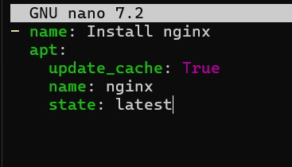
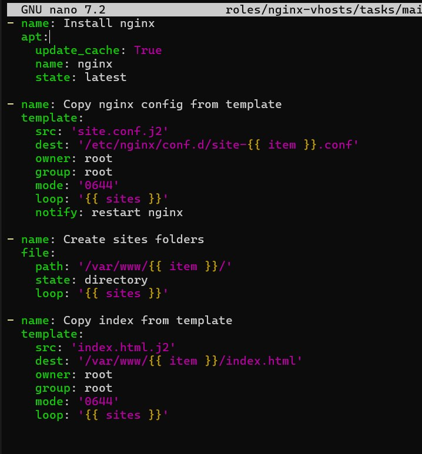

### Генерация конфигураций и обработчики (Handlers)
Создание задач для развертывания виртуальных хостов с использованием Jinja2-шаблона, итерации по списку сайтов через `loop` и настройка обработчика перезапуска службы через `systemd`.

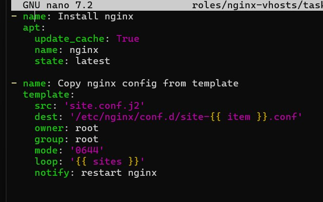
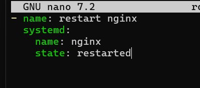

### Шаблоны конфигураций и веб-страниц Jinja2 (`site.conf.j2` и `index.html.j2`)
Объединенные шаблоны для динамического создания виртуальных серверов и генерации HTML-страниц с подстановкой имени сайта через переменную `{{ item }}`.

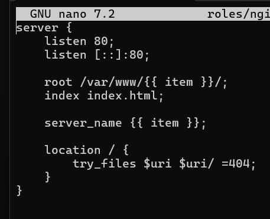
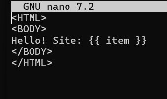

---

## 2. Настройка плейбуков, инвентаря и запуск

### Основной плейбук и инвентарь
Конфигурация сценария выполнения (`playbook.yml`) для группы хостов `webservers` с вызовом роли `nginx-vhosts` и инвентарный файл с параметром локального подключения `ansible_connection=local`.

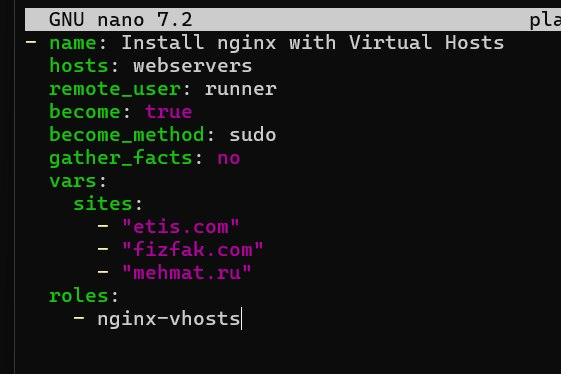
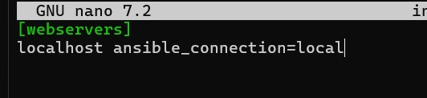

### Скрипт запуска и результат выполнения
Создание управляющего Bash-скрипта с ключами `--diff` и `-K`, а также успешный вывод выполнения плейбука с итоговой статистикой `PLAY RECAP`.

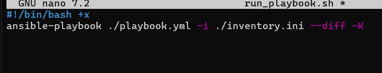
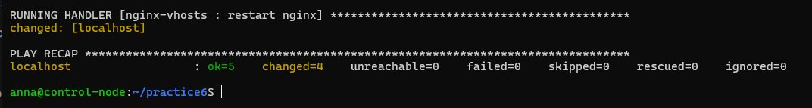

---

## 3. Проверка работоспособности веб-сервера и виртуальных хостов
Комплексная проверка доступности развернутых сайтов (`etis.com`, `fizfak.com`, `mehmat.ru`) с помощью утилиты `curl`, консольного браузера `lynx` и визуального рендеринга страниц.

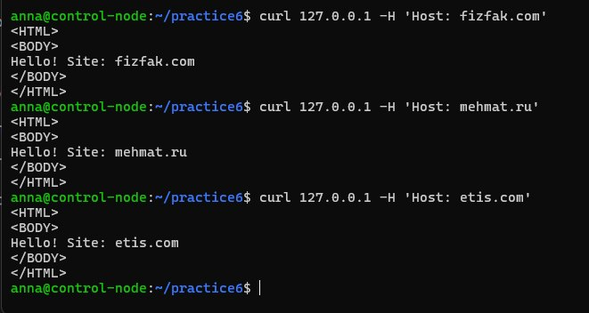

---

## 4. Автоматизация управления файлом `/etc/hosts`
Написание плейбука для динамического добавления сопоставлений IP-адресов и доменов в системный файл `/etc/hosts` с использованием модуля `blockinfile` и вложенных Jinja2-циклов, успешный запуск и проверка содержимого.

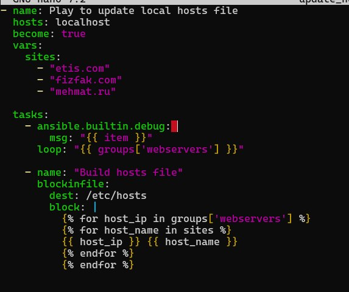
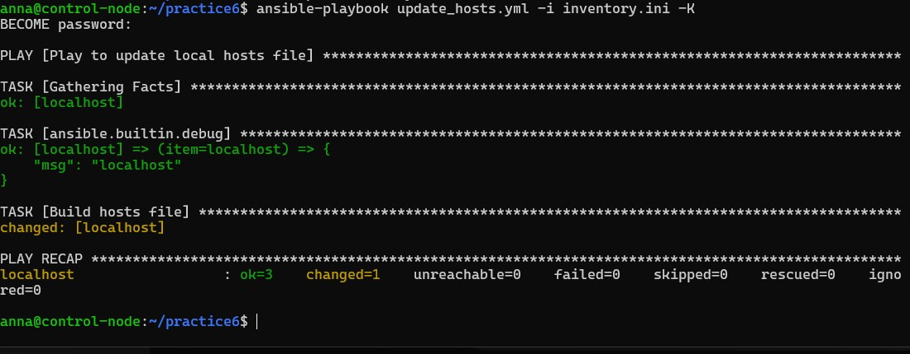
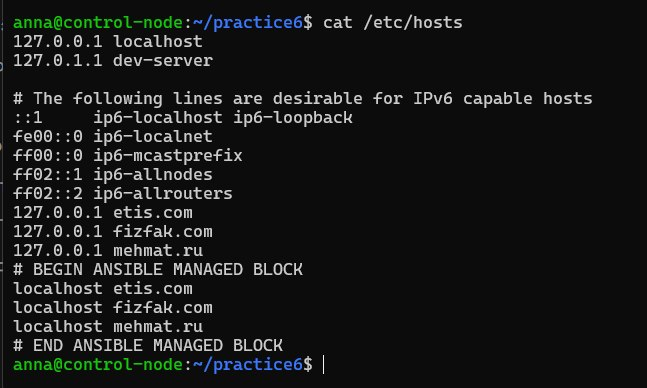

---

## 5. CI/CD пайплайны, линтинг и командная разработка

### Выгрузка проекта на GitHub
Отправка подготовленного локального репозитория в удаленный репозиторий GitHub для настройки автоматизации.

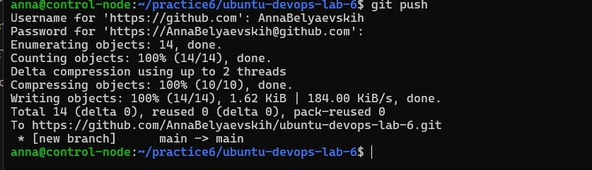

### Конфигурация GitHub Actions и отладка линтинга (`ansible-lint`)
Файл конфигурации CI/CD пайплайна, фиксация ошибки сборки при первом линтинге (`Failure`) и последующее успешное прохождение проверок (`Success`).

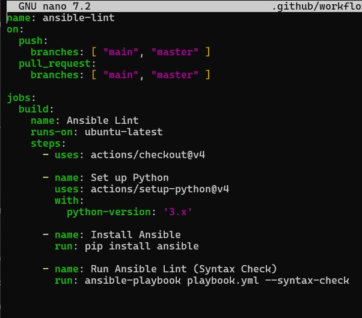
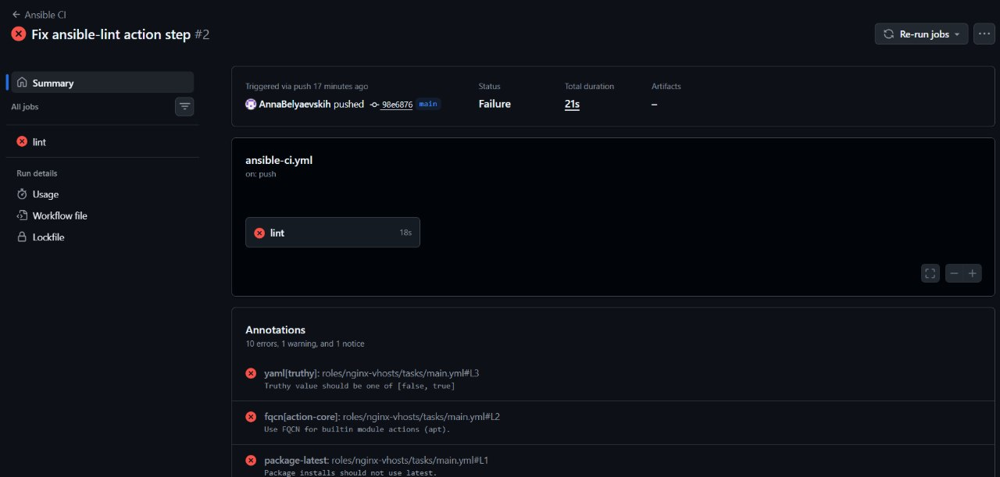
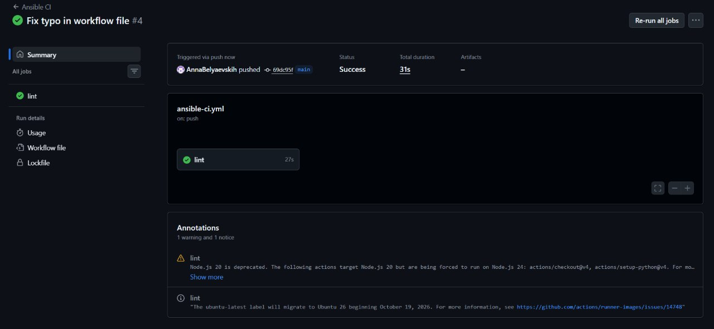

### Pull Request и защита веток (`Protected branches`)
Организация командного процесса: создание Pull Request, прохождение автоматических проверок и блокировка слияния до получения одобрительного отзыва рецензента.

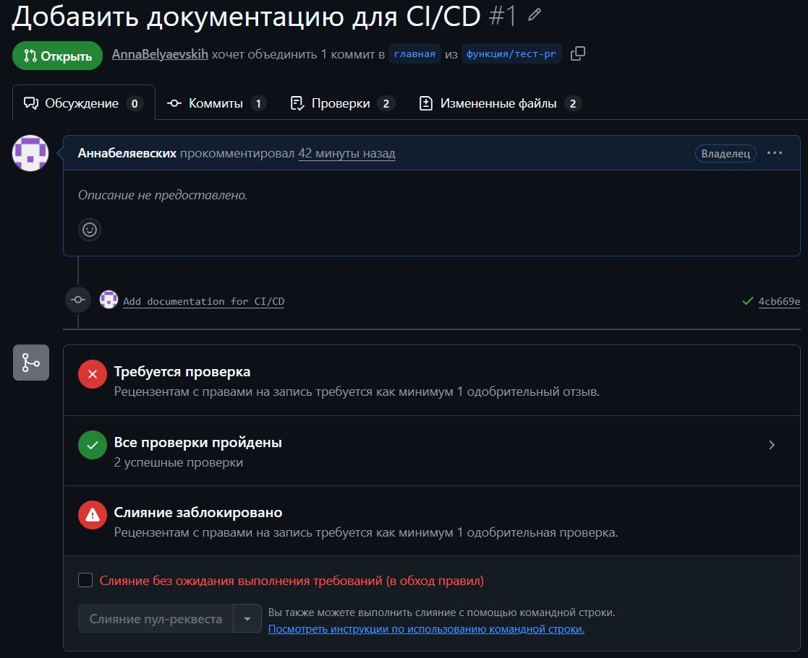